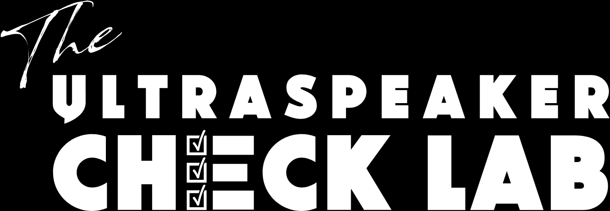

# The Ultraspeaker Check Lab

Controlla una presentazione PowerPoint (.pptx) o Keynote (.key) prima di consegnarla alla regia di un congresso: font, video e audio, immagini, leggibilità (contrasto con lo sfondo e con le foto, grandezza del testo per l’ultima fila, grafici per chi distingue male rosso e verde), formato e struttura, tempi. La scheda **Stile** aiuta a scegliere sfondo, colore del testo e font prima di creare le slide e crea un modello .pptx con queste scelte. Crea il report Critico · Attenzione · OK, senza punteggio: il relatore può cambiare la valutazione di ogni voce e aggiungere una nota. Poi l’esportazione PDF, il nome del file per la regia, la checklist del giorno e i kit di prova video e immagini da aprire in sala.

- **Versione web** (PowerPoint e Keynote): https://niki977.github.io/ultraspeaker-check-lab/
- **Add-in PowerPoint** (Windows, Mac, web): `ultraspeaker-check-lab-manifest.xml`
- Interfaccia e pagine in italiano, inglese, spagnolo, francese e tedesco.

L’analisi avviene interamente nel browser o nel pannello di PowerPoint: la presentazione non viene mai inviata a server esterni.

## Struttura

```
index.html            versione web (.pptx e .key)
addin/taskpane.html   pannello dell’add-in PowerPoint (stessa intestazione e chiusura della versione web)
addin/commands.html   file di funzioni richiesto dal manifest
ultraspeaker-check-lab-manifest.xml   manifest dell’add-in (versione 1.3.0.0)
support.html, privacy.html, terms.html, GUIDA-INSTALLAZIONE.html   pagine di servizio, cinque lingue nel file
guide.html            rimanda a GUIDA-INSTALLAZIONE.html (vecchio indirizzo della guida), conserva ?lang=
guide/                guida d’utilizzo PDF in cinque lingue: src/ (sorgenti), img/ (screenshot), capture.mjs
shared/, fonts/       file comuni del kit 1.4 della linea guida Lab Ultraspeaker: non si modificano qui
assets/css/app.css    stile proprio del Lab, caricato dopo shared/ultraspeaker-lab.css
assets/js/            motore di analisi (pptx, key, testi e contrasto, foto), scheda Stile, interfaccia, traduzioni, legal.js (pagine di servizio)
assets/kit/           modello e file di esempio dei kit di prova (Full HD, un video 4K)
assets/icons/         icone 16–512 px (loghetto della E-checklist; check-lab-mark-*)
assets/img/           logo Check Lab (bianco e nero, SVG e PNG), Arena
assets/fonts/         Champagne & Limousines in .ttf, solo per il report PDF (jsPDF)
assets/vendor/        JSZip 3.10.1 (MIT), jsPDF 2.5.2 (MIT)
test/                 presentazioni di prova con problemi voluti (generali e di leggibilità)
```

## Memoria del browser

`ultraspeaker.lang` (lingua, comune a tutti i Lab) e `ultraspeaker.check.<cosa>`: `settings`, `delivery`, `checklist`, `reviews` (valutazioni e note del report, per nome del file). Le chiavi della 1.x (`ultraspeaker-checklab-…`) vengono copiate una volta e cancellate.

## Aggiornare la guida d’utilizzo

Dalla radice del repository, con Playwright installato (fuori dal repository o con `NODE_PATH`):

1. `node guide/capture.mjs` rifà gli screenshot in `guide/img/<lingua>/` e scrive `guide/img/pins.json` con la posizione dei richiami;
2. se l’interfaccia è cambiata, aggiorna testi e posizioni dei richiami in `guide/src/guide.<lingua>.html`;
3. `node shared/guide/build-guide.mjs` genera `guide/check-lab-guide-<lingua>.pdf`.

## Versioni

- 1.3.0 (novembre 2026): uniformazione alla linea guida Lab Ultraspeaker 1.4 (kit comune, intestazione e chiusura, pagine statiche, guida PDF, manifest).
- 1.2.0 (novembre 2026): report senza punteggio con valutazione del relatore, sala chiesta prima del controllo, scheda Stile con popup del contrasto e font da file, test in sala in Full HD, nuovi loghi.

## Leggibilità: come si calcola

- Contrasto WCAG 2 tra testo e sfondo, con la luce della sala sommata all’immagine proiettata (buio 1%, penombra 5%, luci accese 12% del bianco). Minimo 4,5 : 1, 3 : 1 per titoli e testo grande.
- Testo su foto: la parte della foto sotto il testo viene letta nel browser; conta il 5% dell’area con meno contrasto, anche con una banda al 60% dietro il testo.
- Grandezza (solo se è stata scelta l’ultima fila; altrimenti la chiede prima del controllo): le minuscole alte almeno 1/200 della distanza dell’ultima fila (AVIXA DISCAS), con l’altezza x del font e le bande nere se la slide non riempie lo schermo. In PowerPoint i punti sono su 540 pt di altezza, in Keynote sui pixel della slide.

## Immagine coordinata

Allineata al Brand Book di The Ultraspeaker: logo master con il descrittore CHECK LAB, in cui la E è una checklist a tre righe (quella centrale più corta); palette Stage Black; carattere Champagne & Limousines nell’interfaccia, nelle pagine e nel PDF; angoli 10 px, pulsante primario bianco, nessuna ombra, focus in blu #4F8DFF. Eccezione concordata: nel report Critico è rosso, Attenzione giallo, OK verde. Kit di prova: sfondo nero, logo The Ultraspeaker in basso a destra, testo in Arial per la massima compatibilità con i computer di regia, file di esempio in Full HD (un video 4K), video e audio che partono da soli dopo la transizione.

Nicholas D. Charles (The Ultraspeaker) · info@theultraspeaker.com
